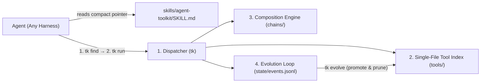

# Architecture: Agent Toolkit

`agent-toolkit` is structured around four **deep modules** with narrow interfaces and strict locality. Every seam is designed to **minimize model cognitive load** and **minimize token consumption**: callers learn one tiny CLI surface, take the fewest possible turns, and receive distilled, low-token outputs.



---

## 1. Dispatcher Module (`tk`)

### Token & Turn Budget Rules

1. **Two-Step Execution (`find → run`)**: `tk find` returns each matching tool's 1-line summary *plus* its copy-pasteable `tk run` usage line. Agents go straight from `tk find` to `tk run` without burning an extra turn on `tk info`.
2. **Distilled Output**: Tools emit compact JSON directly on `stdout` without wrapper ceremony, capped to high-signal fields so tool outputs never flood the context window. When that object has integer `truncated > 0` and the tool declares `--limit`, the runner adds a copy-pasteable `next` command with a larger `--limit`.
3. **Self-Healing Errors**: Missing or invalid flags emit a compact JSON error on `stderr` containing the exact `fix` command to run.

### Interface

| Subcommand | Nature | Contract |
|---|---|---|
| `tk find [query] [--limit <n>] [--namespace <ns>]` | Consumer | Ranks matching tools/chains (or lists all if `[query]` omitted) with inline `tk run` usage. A non-empty query defaults to 5 items (`--limit N` overrides; empty query stays uncapped). `--namespace <ns>` filters by name prefix. A zero-match query writes one stderr JSON line `{"error":"no_match","why":"...","fix":"tk find"}` (`fix` is `tk find --namespace <ns>` when the first query token is an existing namespace), exits 0 with empty stdout, and logs `search_miss`. |
| `tk run <name> [--flag val ...]` | Consumer | Validates flags against the tool header, executes the tool, emits distilled JSON on `stdout`, and logs telemetry. |
| `tk info <name>` | Consumer (Optional) | Prints full argument table and safety details only when deeper inspection is needed. |
| `tk chain <name> ['<step>' ...]` | Consumer / Evolver | `tk chain <name>` (and `tk chain <name> --flag ...`) runs a pipeline; `tk chain <name> '<tool>' '<tool> --flag value'` saves the same chain file as `tk chain save <name> --summary "<text>" --steps '<json>'`. Step $N$'s JSON output feeds step $N+1$. |
| `tk save <name> ...` | Evolver | Turns a working command or script into a single-file tool in `tools/` and validates it with `tk check`. |
| `tk evolve` | Evolver | Inspects `state/events.jsonl`. Auto-promotes an unverified read-only tool or chain only after `check_item` passes and that name has a `run_ok`. Check-passing items with no `run_ok` are reported as `awaiting_live_run` (also with `--no-promote`). `unused_tools` stays empty until 50 `run_ok`/`run_error` events; below that the report sets `unused_reason` `insufficient_telemetry`. |
| `tk prune [<name> ...] [--unused] [--dry-run]` | Evolver | Archives named tools or chains to `state/archive/` (refusing if a kept chain still uses one); `--unused` adds the tools `tk evolve` reports as unused, skipping any a chain references. `--dry-run` previews. `--unused` and `--unused --dry-run` exit 2 with `insufficient_telemetry` when fewer than 50 `run_ok`/`run_error` events exist. Explicit `tk prune <name>` still archives that name. |
| `tk check [name]` | Maintainer | Validates header completeness, flag parity, the dry-run guard, name uniqueness, and name/path layout. It does not start the tool. `--verify` is the runner path. |

### Global Modifiers (Order-Independent)
- `--dry-run`: Prints the resolved command/pipeline without mutating state.
- `--raw`: Accepted for compatibility; `tk run` stdout is already raw, unwrapped JSON (no envelope since `d4c16aa`).

---

## 2. Single-File Tool Contract (`tools/`)

### Why Single-File?
Sidecar manifests (`.yaml` + `.sh`) inevitably drift. In `agent-toolkit`, **the executable file is the manifest**. The indexer parses `# @tk-*` directives from the top comment block of any executable file under `tools/<namespace>/<tool-name>`.

### Header Specification

```bash
#!/usr/bin/env bash
# @tk-name: gh.pr-checks
# @tk-summary: Fetch failing and pending CI checks for a GitHub pull request
# @tk-safety: read-only
# @tk-arg: --repo | required | string | Repository in owner/name format
# @tk-arg: --pr   | required | int    | Pull request number
# @tk-output: json | Array of {name, status, conclusion, url}
# @tk-example: tk run gh.pr-checks --repo cli/cli --pr 123
# @tk-verified: 2026-11-03
```

### Runtime Environment Passed to Tools
Before invoking a tool script, `tk run` parses and validates all `@tk-arg` flags and injects them as normalized environment variables (`TK_ARG_<UPPER_NAME>`, plus `TK_DRY_RUN=0|1`). Tools never need to write fragile `getopts` or `argparse` boilerplate—the dispatcher handles validation and help generation for every language (`.sh`, `.py`, `.ts`).

`run_tool` runs the tool in the caller's cwd (`cwd=None`) and exports `TK_ROOT_DIR` as the toolkit root. The runner does not change `PYTHONPATH`. Relative flag values such as `--path` and `--repo` resolve in that cwd. Tools import `lib` by inserting the toolkit root on `sys.path` from `__file__`, the same way `tk` and `tools/.template` do.

Python tools may import `lib.tool_sdk` (opt-in, stdlib only). The Python example in `tools/.template` reaches the repo root with `sys.path.insert(0, str(Path(__file__).resolve().parents[2]))`, which assumes the tool lives at `tools/<ns>/<file>.py`. The tool stays a single file: the import is not a sidecar manifest, and the `# @tk-*` header remains the contract.

---

## 3. Composition Engine (`chains/`)

Agents chain tools in two ways:

1. **Ad-hoc UNIX Pipes**:
   ```bash
   tk run gh.pr-checks --repo owner/repo --pr 42 | jq '.[] | select(.conclusion == "failure")'
   ```
2. **Saved Deterministic Chains (`chains/<name>.json`)**:
   A declarative list of steps where outputs map cleanly into downstream `--flag` inputs via JSONPath/jq expressions. Once saved, a chain appears in `tk find` identically to an atomic tool—collapsing multi-step workflows into one deterministic call for smaller models. A failing step stops the chain and prefixes `why` with `chain <name> stopped at step <i>/<n> (<tool>): `.

---

## 4. Evolution Loop (`state/` & `tk evolve`)

The toolkit evolves from real agent work rather than speculative upfront design:

1. **Observe (`state/events.jsonl`)**:
   - `search_miss`: Agent searched `tk find` for an intent not yet covered.
   - `run_error`: Tool failed or rejected arguments.
   - `tool_saved`: Agent created a draft tool via `tk save` (`@tk-verified: none`).
2. **Verify (`tk check`)** (`ASabale/agent-toolkit@9c0f0f6`, PR #79; static check is #269):
   - Checks header fields, required flag coverage, and the `TK_DRY_RUN` text guard. It does not start the tool or the chain.
   - Guard: a `mutating` or `destructive` tool with no non-comment `TK_DRY_RUN` reference fails with `<safety> tool must branch on TK_DRY_RUN`.
   - `lint:` rows that existed only because a process ran are gone. A caller that used `tk check` as a smoke run passes `--verify`.
3. **Promote (`tk evolve` and `tk check <name> --verify`)**:
   - **Read-only (`@tk-safety: read-only`)**: `tk evolve` stamps `@tk-verified: <YYYY-MM-DD>` after a passing static check and a `run_ok`. `tk check <name> --verify` calls `run_tool` or `run_chain` on the live path and prints that JSON. It does not rewrite the header.
   - **Mutating and destructive**: `tk evolve` never stamps these. `tk check <name> --verify` calls the runner with `dry_run=True` and `confirmed=False`, so `TK_DRY_RUN=1` is set before `Popen`. Stdout is the runner's dry-run plan JSON. The header stays unchanged.
   - `tk check --verify` and `tk check a b --verify` exit 2 with `fix` `tk check <name> --verify`. A name that fails `tk check` exits 1 with `check_failed` and the check errors in `why`.
4. **Consolidate & Prune (`tk evolve`)**:
   - Flags zero-use or superseded tools for removal and merges overlapping tools so the catalog stays small and low-token.
