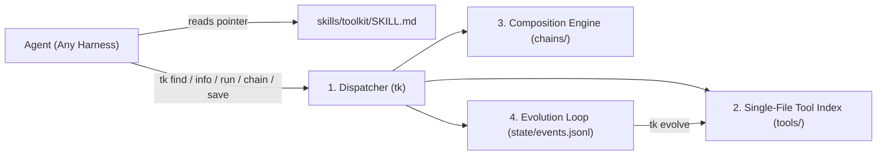

# Architecture: Agent Toolkit

`agent-toolkit` is structured around four **deep modules** with narrow interfaces and strict locality. Callers (both human users and small AI models) learn one tiny CLI surface while the toolkit hides discovery indexing, flag parsing, schema validation, pipeline execution, and evolution tracking.



---

## 1. Dispatcher Module (`tk`)

### Interface

Seven subcommands cover both the **Consumer** and **Evolver** natures:

| Subcommand | Nature | Contract |
|---|---|---|
| `tk find "<query>"` | Consumer | Ranks tools and chains by intent; logs a `miss` event if empty. |
| `tk info <name>` | Consumer | Emits the full contract, required `--flags`, and copyable examples for `<name>`. |
| `tk run <name> [--flag val ...]` | Consumer | Validates required flags against the tool header, executes the tool, wraps output in the standard JSON envelope, and logs execution telemetry. |
| `tk chain <name> [steps...]` | Consumer / Evolver | Runs or saves a deterministic pipeline where step $N$'s JSON `data` feeds step $N+1$. |
| `tk save <name> ...` | Evolver | Scaffolds or promotes a command/script into a valid single-file tool in `tools/`, then runs `tk check`. |
| `tk evolve` | Evolver | Inspects `state/events.jsonl` (misses, failures, repeated commands) and proposes or promotes new tools. |
| `tk check [name]` | Maintainer | Validates header completeness, flag-parser parity, dry-run safety, and executable permissions. |

### Global Modifiers (Order-Independent)
- `--dry-run`: Prints the resolved command/pipeline without mutating state.
- `--raw`: Emits raw `data` on `stdout` instead of the JSON envelope (for shell piping).

---

## 2. Single-File Tool Contract (`tools/`)

### Why Single-File?
Sidecar manifests (`.yaml` + `.sh`) inevitably drift. In `agent-toolkit`, **the executable file is the manifest**. The indexer parses `# @tk-*` directives from the top comment block of any executable file under `tools/<namespace>/<tool-name>`.

### Header Specification

```bash
#!/usr/bin/env bash
# @tk-name: gh.pr-checks
# @tk-summary: Fetch failing and pending CI checks for a GitHub pull request
# @tk-safety: read-only
# @tk-arg: --repo | required | string | Repository in owner/name format
# @tk-arg: --pr   | required | int    | Pull request number
# @tk-output: json | Array of {name, status, conclusion, url}
# @tk-example: tk run gh.pr-checks --repo cli/cli --pr 123
# @tk-verified: 2026-11-03
```

### Runtime Environment Passed to Tools
Before invoking a tool script, `tk run` parses and validates all `@tk-arg` flags and injects them as normalized environment variables (`TK_ARG_<UPPER_NAME>`, plus `TK_DRY_RUN=0|1`). Tools never need to write fragile `getopts` or `argparse` boilerplate—the dispatcher handles validation and help generation for every language (`.sh`, `.py`, `.ts`).

---

## 3. Composition Engine (`chains/`)

Agents chain tools in two ways:

1. **Ad-hoc UNIX Pipes**:
   ```bash
   tk run gh.pr-checks --repo owner/repo --pr 42 --raw | jq '.[] | select(.conclusion == "failure")'
   ```
2. **Saved Deterministic Chains (`chains/<name>.json`)**:
   A declarative list of steps where outputs map cleanly into downstream `--flag` inputs via JSONPath/jq expressions. Once saved, a chain appears in `tk find` and `tk info` identically to an atomic tool—collapsing multi-step workflows into one deterministic call for smaller models.

---

## 4. Evolution Loop (`state/` & `tk evolve`)

The toolkit evolves from real agent work rather than speculative upfront design:

1. **Observe (`state/events.jsonl`)**:
   - `search_miss`: Agent searched `tk find` for an intent not yet covered.
   - `run_error`: Tool failed or rejected arguments.
   - `tool_saved`: Agent created a draft tool via `tk save` (`@tk-verified: none`).
2. **Verify (`tk check`)**:
   - Checks header fields, required flag coverage, and `--dry-run` behavior.
3. **Promote (`tk evolve`)**:
   - **Read-only (`@tk-safety: read-only`)**: Auto-verified via live/smoke execution and marked `@tk-verified: <date>`.
   - **Mutating (`@tk-safety: mutating`)**: Verifies `--dry-run` output and prompts human/agent confirmation before marking verified.
   - **Destructive (`@tk-safety: destructive`)**: Requires explicit human sign-off and mandatory `--dry-run` support.
